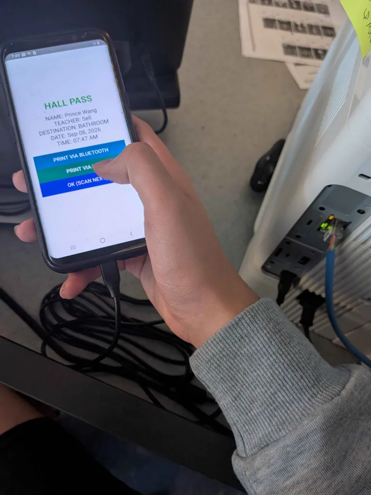
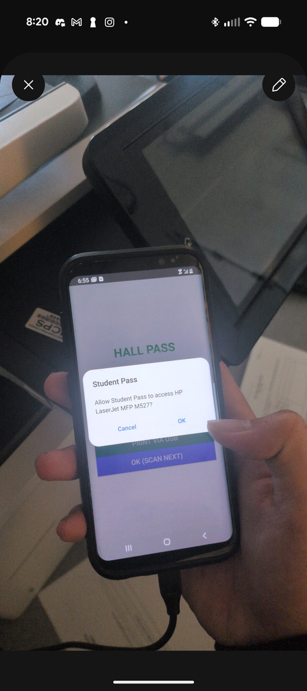
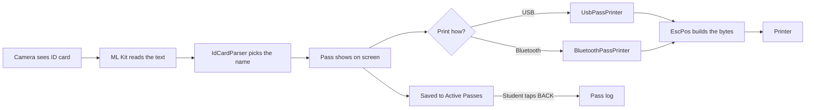
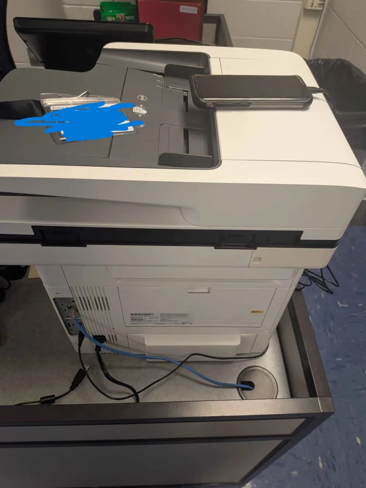
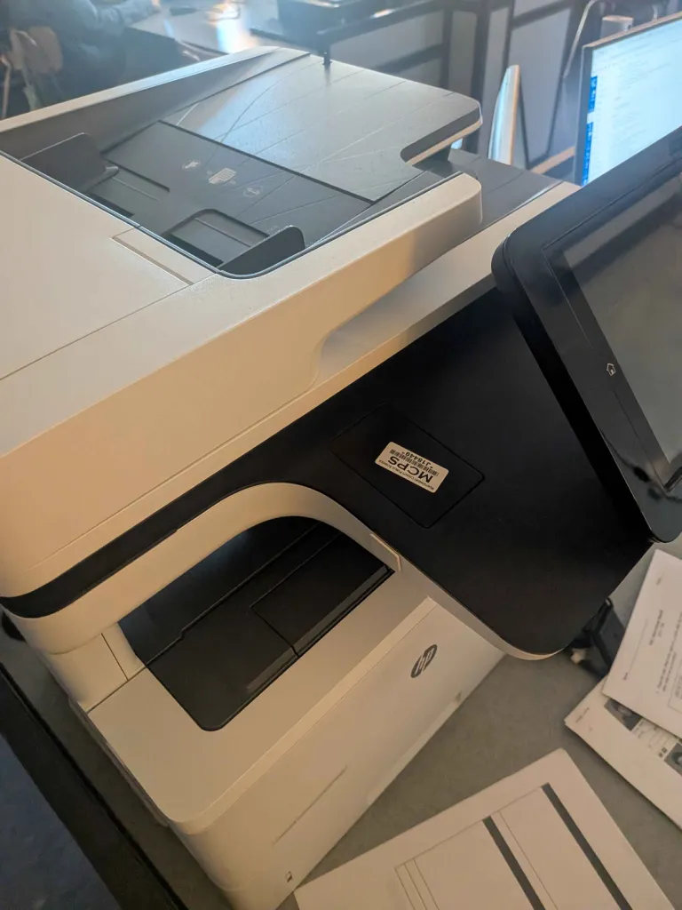
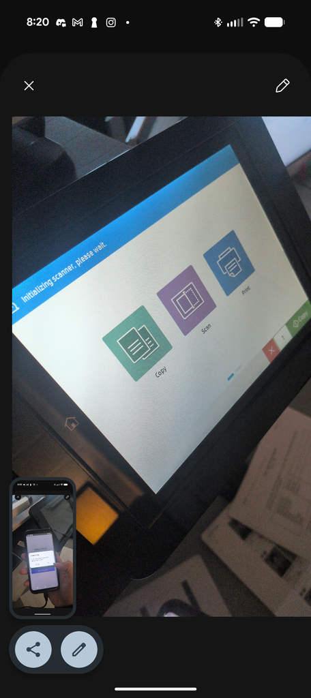
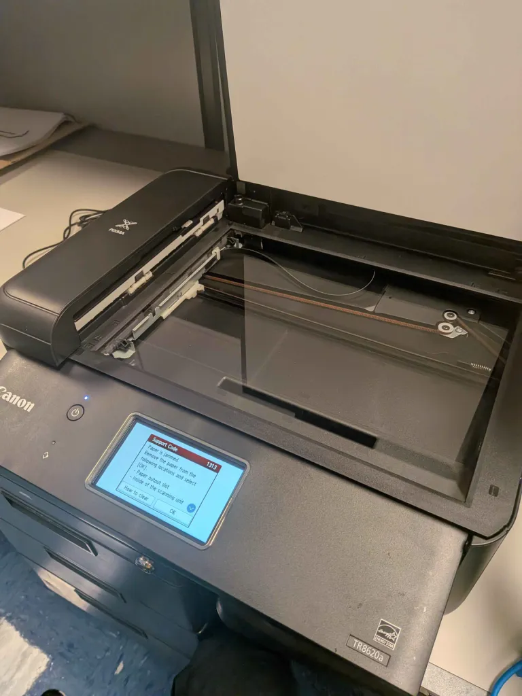
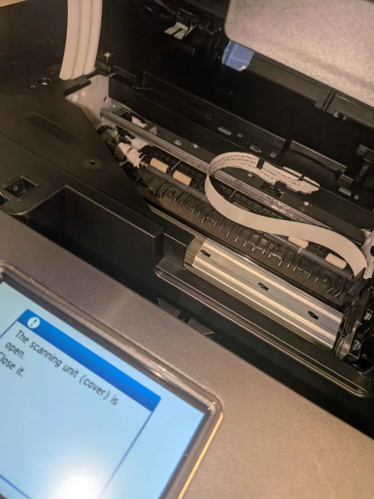

<div align="center">

# Student Pass

**Scan an ID. Print a hall pass. Know who's out.**




</div>

An Android app that turns a phone into a hall pass machine. You point the camera at a student's ID card, it reads their name, and it prints a pass on the classroom printer. It also keeps track of who's out right now and when they came back.

I built this for Sell's classroom. It runs on an old Samsung Galaxy S8 that sits on top of the HP printer, plugged in with a USB cable.

<details>
<summary><b>Table of contents</b></summary>

- [What it does](#what-it-does)
- [How to use it](#how-to-use-it)
- [How a pass gets made](#how-a-pass-gets-made)
- [The setup in the classroom](#the-setup-in-the-classroom)
- [Building it](#building-it)
- [How the code is laid out](#how-the-code-is-laid-out)
- [The printing saga](#the-printing-saga)
- [Full timeline](#full-timeline)
- [Things to know](#things-to-know)

</details>

## What it does

- [x] **Scans ID cards.** The camera reads the card with Google ML Kit (all on the phone, no internet needed) and pulls out the student's name. If the card says "Wang, Prince" it flips it to "Prince Wang" so it reads normally.
- [x] **Lets you pick where they're going.** Bathroom, Nurse, Main Office, Counselor, Library, Water Fountain, Locker, or **Other** to type in anything else.
- [x] **Makes the pass.** Name, teacher, destination, date, and time.
- [x] **Prints it.** Over USB (what we actually use) or Bluetooth if you have a paired receipt printer.
- [x] **Remembers the teacher.** Type the teacher's name once, check "Set as default", and it sticks between launches.
- [x] **Tracks who's out.** Every printed pass shows up under **Active Passes**. When the student comes back you tap **BACK** and it logs the return time.
- [x] **Keeps a pass log.** Full history of who left, where they went, and when they came back. You can delete single entries or wipe the whole thing.

Here's roughly what comes out of the printer:

```text
            HALL PASS
--------------------------------
NAME: Prince Wang
TEACHER: Sell
DESTINATION: NURSE
DATE: Sep 08, 2026
TIME: 07:47 AM
--------------------------------

Signature: ______________
```

## How to use it

1. Open the app. Type the teacher name at the top if it isn't already there.
2. Pick a **Destination**. It starts on Bathroom. If you pick **Other**, a box shows up so you can type where they're going.
3. Hold the student's ID under the camera and tap <kbd>CAPTURE ID CARD</kbd>.
4. Check the pass on screen, then tap <kbd>PRINT VIA USB</kbd> (or <kbd>PRINT VIA BLUETOOTH</kbd>).
5. Tap <kbd>OK (SCAN NEXT)</kbd> to go back to the camera.
6. When the student gets back, tap <kbd>ACTIVE PASSES</kbd>, find them, and tap <kbd>BACK (STUDENT RETURNED)</kbd>.

> [!TIP]
> The destination you pick stays picked until you change it, so if you're sending a few kids to the library in a row you only have to set it once.

> [!NOTE]
> The first time you print over USB, Android asks if Student Pass can use the printer. Tap **OK**. It only asks once per time the printer gets plugged in.

<p align="center">
  
</p>

## How a pass gets made



## The setup in the classroom

| | |
| --- | --- |
| **Phone** | Samsung Galaxy S8 (Android 9). Old, but it works fine for this. |
| **Printer** | HP LaserJet MFP M527, the big school copier. |
| **Cable** | USB from the phone into the printer's USB port in the back. The phone acts as the USB host, so on most phones you need an OTG adapter. |

<p align="center">
  
  
</p>

## Building it

You need JDK 17 or 21 and the Android SDK (compile SDK 34). The app supports Android 7.0 (API 24) and up.

```bash
./gradlew assembleDebug
```

Then install it on a phone with USB debugging turned on:

```bash
./gradlew installDebug
```

There are some unit tests for the name reader that run on your computer, no phone needed:

```bash
./gradlew test
```

If the scanner grabs the wrong name, you can see exactly what the camera read off the card:

```bash
adb logcat -s StudentPass
```

> [!WARNING]
> This Gradle version (8.11.1) can't run on Java 25. If the build fails with a weird error that just says `25.0.2`, point `JAVA_HOME` at JDK 17 or 21 instead.

## How the code is laid out

Everything lives in `app/src/main/java/com/example/studentpass/`.

| File | What it does |
| --- | --- |
| [App.java](app/src/main/java/com/example/studentpass/App.java) | The whole UI: camera screen, teacher and destination picker, pass screen, active passes, pass log. Also saves the log to the phone. |
| [IdCardParser.java](app/src/main/java/com/example/studentpass/IdCardParser.java) | Figures out which line on the card is the student's name. Reads top-left to bottom-right and skips school words like "COUNTY" or "STUDENT". |
| [EscPos.java](app/src/main/java/com/example/studentpass/EscPos.java) | Turns the pass text into the bytes that get sent to the printer. |
| [UsbPassPrinter.java](app/src/main/java/com/example/studentpass/UsbPassPrinter.java) | Finds the printer on USB, asks for permission, and sends the pass. |
| [BluetoothPassPrinter.java](app/src/main/java/com/example/studentpass/BluetoothPassPrinter.java) | Same thing but over Bluetooth to an already paired printer. |

## The printing saga

Getting the camera to read a name was the easy part. Getting a pass to come out of the printer correctly took about three weeks. I fixed things by saving checkpoint commits and testing each one on the real printer, so the git history pretty much tells the whole story.

| # | Problem | What you saw | Fixed in | Status |
| --- | --- | --- | --- | --- |
| 1 | Bad line breaks | Pass came out messed up | `b84c2f5`, `febc26d` |  |
| 2 | Crash on launch | App wouldn't even open, so no printing | `1276971` |  |
| 3 | No end-of-job signal | Printer got the pass but never printed it | `58b3e1b` |  |

### Problem 1: The pass printed out weird

 

The first version of the USB printing used a format called ESC/POS. That's the language small receipt printers (like the ones at a grocery store) speak. The HP M527 isn't a receipt printer though. It's a full office laser printer, so it doesn't play by the same rules.

The biggest issue was line breaks. The first version ended every line with just `\n` (a "line feed"). A lot of printers take that literally: move the paper down one line, but don't go back to the left edge. So each line starts where the last one ended and the text drifts across the page.

<details>
<summary><b>See the fix</b></summary>

`b84c2f5` (Sep 8) switched every line ending to `\r\n` (go back to the left edge, *then* move down). It also started sending the pass in small chunks that match what the printer's USB port takes at once, instead of shoving it all through in one go. Then `febc26d` (Sep 9) made sure line endings never double up into `\r\r\n` (which gives you extra blank lines) and added the divider lines.

```diff
- + "\n" + passText + "\n"
+ String normalized = passText.replace("\r\n", "\n").replace("\n", "\r\n");
+ stream.write((normalized + "\r\n").getBytes(StandardCharsets.ISO_8859_1));
```

</details>

### Problem 2: The app crashed and couldn't print again

 

Right after the line break fix, the app started crashing as soon as you opened it. Which means you couldn't print anything at all.

The cause was one small change in `UsbPassPrinter`. When Android asks "can this app use the USB printer?", it sends the answer back to the app through something called a broadcast receiver. To set that up, you have to tell Android whether other apps are allowed to talk to it, by passing either `RECEIVER_EXPORTED` or `RECEIVER_NOT_EXPORTED`.

In `b84c2f5` that got changed to pass `0` (neither one) on phones older than Android 13. The Galaxy S8 runs Android 9, so it hit that path. The helper we use (`ContextCompat.registerReceiver`) refuses to run without one of the two flags and throws an error. And since the USB printer gets set up the moment the app starts, the whole app went down before you could even scan a card.

<details>
<summary><b>See the fix (and the stuff I tried first)</b></summary>

While hunting for it I tried a few other things:

- `febc26d` (Sep 9) moved the USB printer search off the main thread so the S8 wouldn't freeze, and made sure closing the app couldn't crash on cleanup.
- `c1e05a1` (Sep 9) locked the camera to 1280x720 and made it catch any camera error instead of crashing, since older Samsung cameras can be picky. (Also deleted a random WPILib robotics file that had snuck into the project.)

The real fix was `1276971` (Sep 10), which put the right flag back:

```diff
- int flag = Build.VERSION.SDK_INT >= Build.VERSION_CODES.TIRAMISU
-         ? ContextCompat.RECEIVER_EXPORTED
-         : 0;
  ContextCompat.registerReceiver(activity, permissionReceiver,
-         new IntentFilter(ACTION_USB_PERMISSION), flag);
+         new IntentFilter(ACTION_USB_PERMISSION), ContextCompat.RECEIVER_NOT_EXPORTED);
```

</details>

> [!IMPORTANT]
> The commit message says it all: *"this was working before fetching yesterdays."* Only our app should ever get that USB answer anyway, so "not exported" was the right call from the start.

### Problem 3: The pass wouldn't print at all

 

This was the big one. The app would say "Printing...", the printer would get the data, and then... nothing. No paper came out. It would just sit there until you unplugged the cable or walked up and tapped Print on the screen.

<p align="center">
  
</p>

Turns out the HP doesn't know a print job is *finished* unless something tells it. Normal print jobs from a computer come wrapped in HP's job language (PJL), which has a clear "end of job" marker. ESC/POS doesn't have anything like that, because receipt printers just print as the bytes come in. So the HP kept waiting for more of a job that was never going to show up.

The fix in `58b3e1b` was to tack HP's "this job is done" signal onto the end of every pass:

```java
byte[] uel = {0x1B, 0x25, 0x2D, 0x31, 0x32, 0x33, 0x34, 0x35, 0x58}; // ESC%-12345X
stream.write(escPosPayload);
stream.write(uel);                                                  // leave the current language
stream.write("@PJL EOJ\r\n".getBytes(StandardCharsets.ISO_8859_1)); // "end of job"
stream.write(uel);                                                  // and leave again
```

As soon as the HP sees that, it prints the page.

<details>
<summary><b>Other stuff that commit fixed</b></summary>

- **Keeps the USB connection open** between passes instead of opening and closing it every time, and only reopens it if something actually goes wrong.
- **Blocks double taps.** If you hit Print again while a pass is still sending, it tells you to hang on instead of sending two jobs on top of each other.
- The end-of-job part only goes on USB prints, since it's an HP thing. The Bluetooth path still sends plain ESC/POS.

</details>

### Not every problem was code

The Canon TR8620a in the room jammed (support code 1313) and I had to pop open the scanning unit to get the paper out. Sometimes the printer is just the printer.

<p align="center">
  
  
</p>

## Full timeline

| Date | Commit | What happened |
| --- | --- | --- |
| Aug 29 | `3d88527` | Started the project |
| Aug 29 | `75dcb66` | Camera and ID card scanning working |
| Aug 29 | `b7ec189` | Added Bluetooth printing and the name parser with tests |
| Aug 31 | `1758f95` | Comments everywhere |
| Sep 1 | `d39edfa` | Added USB printing and moved the pass format into `EscPos` |
| Sep 8 | `b84c2f5` | Fixed line breaks and chunked USB sends, added teacher name. Also introduced the crash |
| Sep 9 | `febc26d` | Cleaner pass layout, USB search moved off the main thread |
| Sep 9 | `c1e05a1` | Camera made sturdier on older phones |
| Sep 10 | `1276971` | Fixed the crash on open (receiver flag) |
| Sep 17 | `58b3e1b` | **Passes finally print on the HP** |
| Sep 18 | `58aaa7d` | Wrote down Sell's request to track when students come back |
| Sep 19 | `cf8b70f` | Active passes screen with a BACK button |
| Sep 19 | `41b23ef` | Pass log with select and delete |
| Oct 28 | | Destination picker instead of always BATHROOM |

## Things to know

> [!CAUTION]
> The pass log only lives on the phone. Uninstalling the app or clearing its data wipes it.

- Passes made before the destination picker existed show up as BATHROOM in the log, since that's all they could be back then.
- To change the list of destinations, edit `DESTINATIONS` near the top of `App.java`.
- The name reader grabs the first line on the card that looks like a name. Unusual card layouts can throw it off. Hold the card flat and fill the screen with it.
- If Print says "Plug the printer in with an OTG adapter first," the phone isn't seeing the printer. Check the cable and try again.
